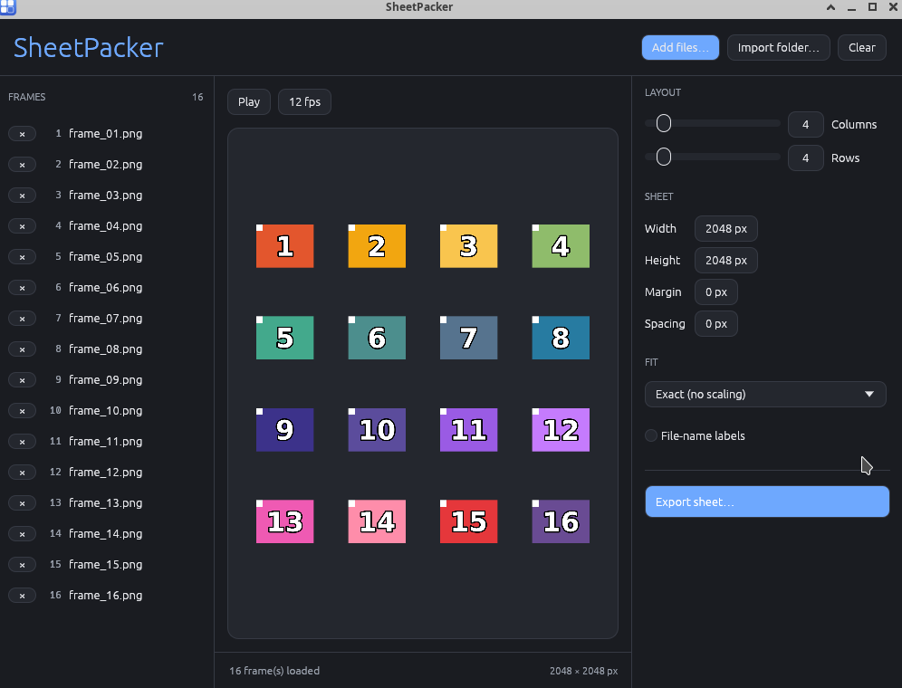
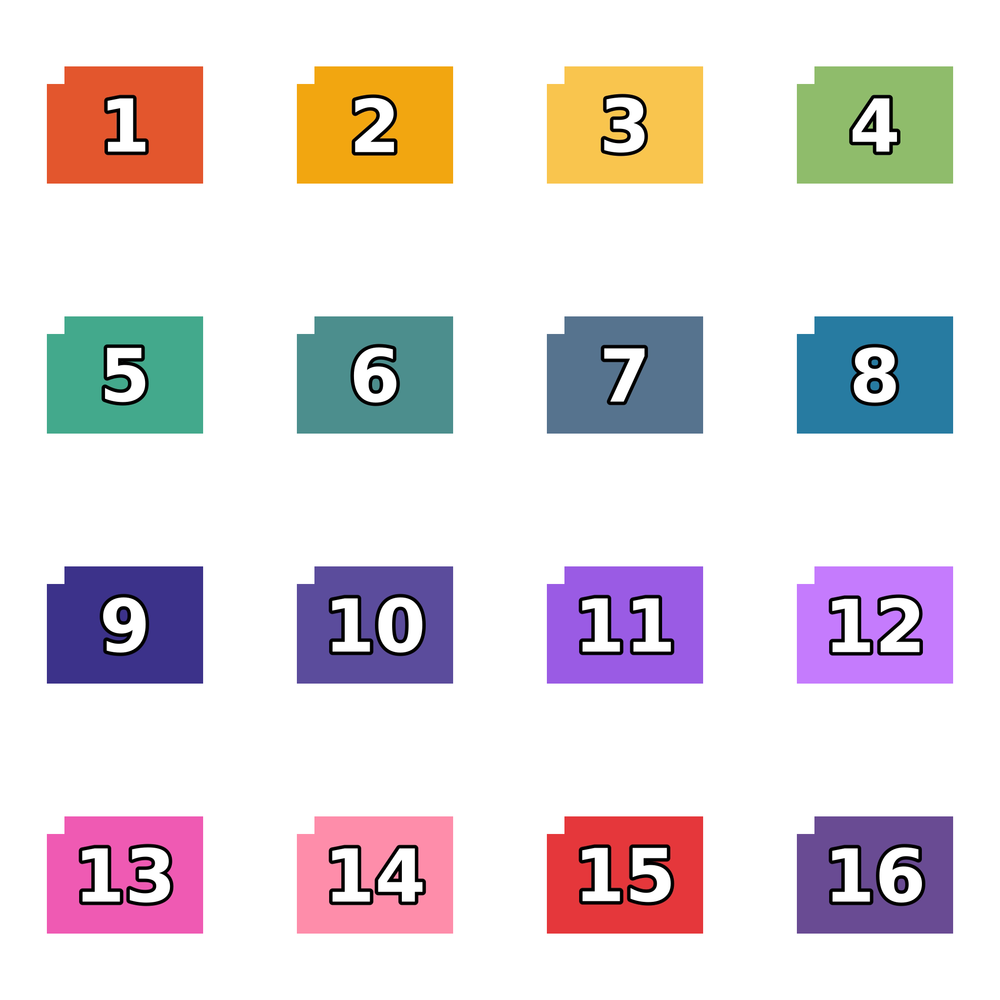
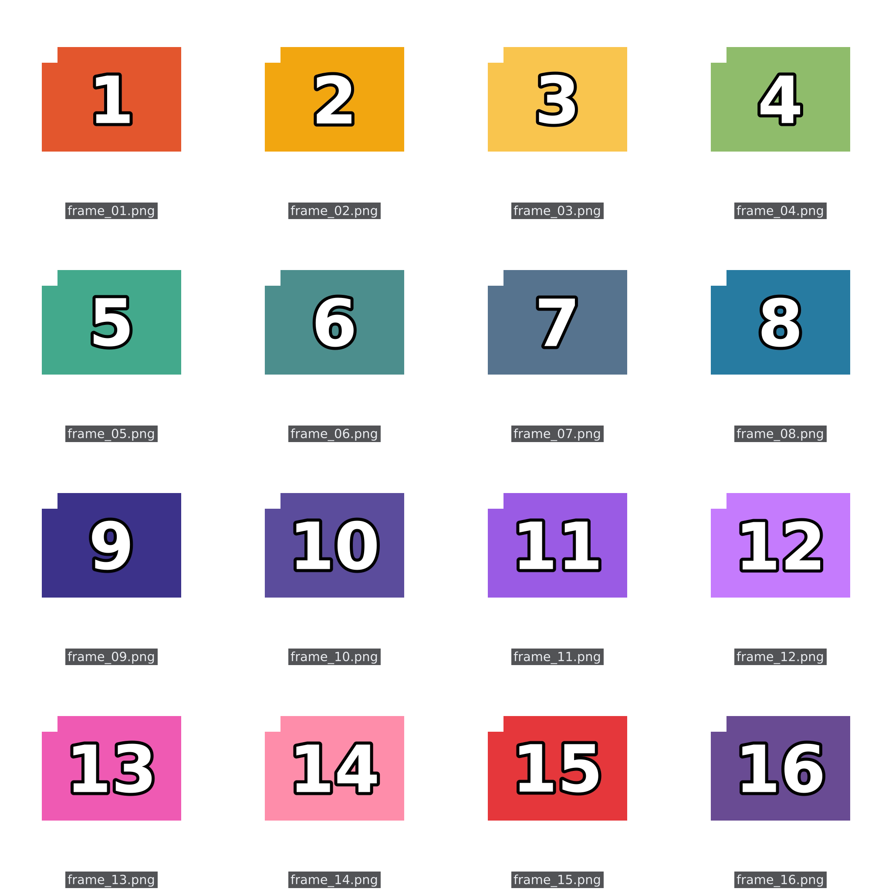
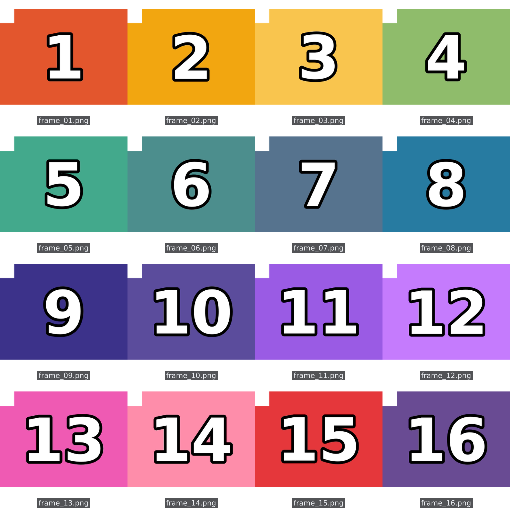

# SheetPacker

<p align="center">
  
</p>

**A fast, free, cross-platform PNG-sequence → flipbook / sprite sheet packer.**

Drop in a folder of PNG frames and get back a single packed sheet — columns,
rows, output size, margin, and spacing all configurable. A free alternative to
paid sprite-sheet tools like TexturePacker, built in Rust with `egui`.



## Features

- **Live preview** — see the composed sheet as you tweak settings.
- **Drag to reorder** — reorder frames in the list; order feeds straight into the sheet.
- **Grid layout** — columns × rows, plus final sheet **width/height**, **margin**, and **spacing**.
- **Fit modes** — `Exact` (no scaling, default), `Letterbox` (keep aspect), or `Stretch` to fill each cell.
- **File-name labels** — optionally stamp each frame's file name beneath it — ideal for **contact sheets**.
- **Flipbook playback** — play the frames back at a chosen FPS to preview the motion.
- **Natural sort** — `frame_2.png` comes before `frame_10.png` automatically.
- **Overflow handling** — warns when frames exceed the grid and offers a one-click **Auto-fit grid**.
- **Transparent empty cells** — leftover cells are alpha 0, so you can composite over anything.
- **Cross-platform** — Windows, Linux, macOS (Rust + `eframe`).
- **Command-line mode** — headless batch export, no GUI required.

## Download

Grab the latest build from the [**Releases**](../../releases/latest) page:

- **Windows** — `SheetPacker-Setup.exe` (per-user installer, no admin needed) or the portable `.zip`.
- **Linux / macOS** — build from source (below).

> **Windows SmartScreen:** the app is currently unsigned, so Windows may show a
> "Windows protected your PC" warning on first run. Click **More info → Run anyway**,
> or right-click the file → **Properties → Unblock** before running.

## Build from source

Requires a [Rust toolchain](https://rustup.rs).

```bash
cargo run --release
```

Run it with frames preloaded from a path:

```bash
cargo run --release -- ./frames
```

### Cross-compiling for Windows (from Linux)

Requires a portable [LLVM-MinGW](https://github.com/mstorsjo/llvm-mingw) toolchain:

```bash
LLVM_MINGW=/path/to/llvm-mingw ./build-windows.sh
# -> target/x86_64-pc-windows-gnu/release/sheetpacker.exe
```

## Command line

For batch/scripting, a headless export mode is built in:

```bash
sheetpacker ./frames --out sheet.png --cols 4 --rows 4 --size 2048x2048 --fit exact
```

Options: `--out <file>`, `--cols N`, `--rows N`, `--size WxH`, `--margin N`,
`--spacing N`, `--fit exact|letterbox|stretch`, `--labels`.

## Example output

16 frames packed into a 4×4 sheet with **Exact** fit (the default — frames at
native size, no scaling):



The same sheet with **file-name labels** enabled — ideal for contact sheets:



And with **Letterbox** fit + labels, a classic thumbnail contact sheet:



## License

[MIT](LICENSE) — free to use, modify, and redistribute.
